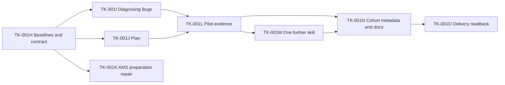

# Shared skills refocus: preparation readback

**Authority:** [owner preparation/failure correction](../wiki/context-skills-refocus.md#jot-fe0364a6-270b-4205-a86a-c49f637e3b22), 2026-11-02. Map and Plan; stop at Prepare.
**Destination:** [S-000A](../landmarks/LMK-004-rsi-loop-during-build/specs/S-000A-skills-refocus/SPEC.md), under LMK-004.
**Target:** checked non-site documentation to main. Implementation, trials, activation and installation remain withheld.

Map counts: 1 Specs, 8 Tasks, 0 empty tasks/

## Work through the system

Confirmed job/workflow intent -> Workbench destination and bounded agent assignments -> source methods/helpers in KaydenClark/skills -> independent pruning and actual pilot outcomes -> qualification/disposition -> conditional per-skill rollout -> truthful catalog metadata/docs and safe evidence/readback. S-013 detects preparation bypasses and routes them to their source repair. S-006/S-007 retain stored/presented evidence; S-008 owns public explanations at accepted pins.

Preparation maps the full destination and supplies eight smart-zone assignments with genuine artifact prerequisites. Both pilots and explicit owner authorization gate rollout. Missing causal evidence, contract decisions and evaluation capability remain gaps, not invented success.

## Prepared assignments and dependency graph

All Tasks are held by owner:skills-refocus-implementation and S-000A remains planned, with no execution approval or claim. This is the owner's requested Prepare endpoint. Conditional future readiness is not permission to dispatch.

| Task | Delivered result | Required input / additional release |
|---|---|---|
| [TK-001H](../landmarks/LMK-004-rsi-loop-during-build/specs/S-000A-skills-refocus/tasks/TK-001H/TASK.md) | Exact baselines and two-pilot comparison contract; remaining inventory retained | Current evidence; no candidate method edits or trial calls |
| [TK-001I](../landmarks/LMK-004-rsi-loop-during-build/specs/S-000A-skills-refocus/tasks/TK-001I/TASK.md) | Diagnosing Bugs candidate and actual focused author/pruner checks | TK-001H; approved pilot contract |
| [TK-001J](../landmarks/LMK-004-rsi-loop-during-build/specs/S-000A-skills-refocus/tasks/TK-001J/TASK.md) | Plan candidate and clean vertical Task outputs | TK-001H; approved pilot contract |
| [TK-001K](../landmarks/LMK-004-rsi-loop-during-build/specs/S-000A-skills-refocus/tasks/TK-001K/TASK.md) | Evidence-backed AMS preparation-route repair and recurrence proof | TK-001H baseline; S-013 detection evidence checked directly |
| [TK-001L](../landmarks/LMK-004-rsi-loop-during-build/specs/S-000A-skills-refocus/tasks/TK-001L/TASK.md) | Separate observed pilot comparisons and honest gate verdicts | TK-001I and TK-001J; approved finite trials |
| [TK-001M](../landmarks/LMK-004-rsi-loop-during-build/specs/S-000A-skills-refocus/tasks/TK-001M/TASK.md) | One further named skill through the proven approach; remaining roster and next bounded assignments | TK-001L evidence; both pilots must qualify and owner releases rollout |
| [TK-001N](../landmarks/LMK-004-rsi-loop-during-build/specs/S-000A-skills-refocus/tasks/TK-001N/TASK.md) | Accurate descriptions, composition/prerequisites and credit for this three-skill cohort | Pilot evidence TK-001L and nonpilot evidence TK-001M |
| [TK-001O](../landmarks/LMK-004-rsi-loop-during-build/specs/S-000A-skills-refocus/tasks/TK-001O/TASK.md) | Safe comparison/disposition and actual source-delivery readback | TK-001N; actual source gates; installation/site work retain separate authority |

After authorization and the frozen contract, the two pilot lanes can run in parallel; the system-route repair is independent of their outcomes but must use a nonoverlapping source lane or serialize shared writes. Each Task includes investigation, repair/QA and return within its stated scope. Formal trials have their own finite Task and release; no evaluator or worker is launched by preparation.

### Whole-catalog continuation

The destination includes all skills, not only the pilots or first cohort. TK-001H retains the full source/installed inventory; TK-001M handles one named further skill and prepares the next actual frontier from its findings. Repeat that bounded pattern with new native Task identities, source evidence and applicable authority until every entry has a verified improvement, supported no-change disposition or explicitly owned remaining work. Cohort metadata/readback Tasks also get fresh identities. Do not invent detailed repairs before the pilot results and per-skill findings exist, silently narrow scope, recycle an unlimited Task or imply that three skills complete the Spec. Helper extraction, consolidation approval, qualification, publication and later-use gaps remain explicit throughout.

## Documentation reconciliation

| Owner | Preparation change / retained boundary |
|---|---|
| Wiki and feedback | Sourced catalog decisions, Prepare stop and owner-recorded AMS failure; durable report and append-only feedback entry. |
| Blueprint | Concrete methods for distinct jobs and reliability as an improvement; retains the existing shared-skills/website/RSI destination. |
| SKILLS | Shared-repository changes still use Workbench Map/Plan and the named source owner; clarification is not behavioral proof. |
| LMK-004 | New child destination and success condition; existing comparison safeguards and stopped work survive. |
| S-013 / TK-001D | Detection cases for missing preparation, cross-repository routing, valid existing preparation and Prepare-stop violations; original execution hold retained. |
| S-008 | Future accepted pins must explain composition, actual prerequisites and adaptation credit; no site files changed and earlier pin evidence remains historical. |
| S-011 | Separate catalog scope linked; partial drafts, failed trials, counters, qualification and installation gates preserved. |
| S-001 / S-002 | No rewrite: S-001 already assesses landmark outcomes; S-002 retains its frozen evaluation contracts and campaign stops. This preparation changes neither. |
| AGENTS / RUNBOOK / ARCHITECTURE | Existing authority, Map/Plan and claim ownership routes already apply; no duplicated new process or managed-tool edit. Root-cause repair remains planned, not proved. |
| GLOSSARY / source repository | Catalog labels are specified by confirmed intent; source README/frontmatter, helper contracts, notices/history and evaluation records are future source work, not edited here. |

## Verification and limits

Map checkpoint46db382 saved S-000A planned with zero Tasks and one tracked empty tasks folder; native doctor --map against mainf1ff5c8 verified those counts. Plan then allocated the eight Tasks through next-id and replaced the empty marker. Confirmation cites actual intent; execution approval is deliberately absent. Final committed-tree counts and checks accompany publication. No skill method, trial result, independence verdict or human judgment is manufactured. Source/installed counts are dated inventory, not activation evidence.
